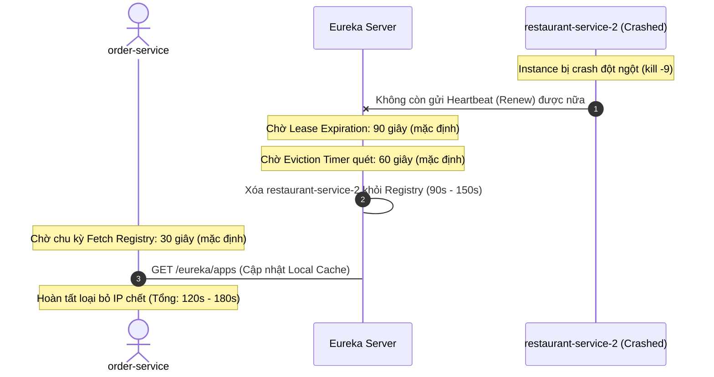

# BÁO CÁO BÀI TẬP 4 — PHÂN TÍCH SỰ CỐ SERVICE DISCOVERY KHI SCALE HỆ THỐNG FOODX

**Môn học:** Kiến trúc Hệ thống / Microservices (IT209)  
**Session 02:** Từ Monolithic đến Microservice  
**Cấp độ:** Phân tích chuyên sâu  
**Tình huống:** Scale `restaurant-service` từ 1 lên 4 instance nhưng `order-service` vẫn chỉ gọi được 1 instance; kiểm tra thấy cấu hình Eureka Client của `restaurant-service` bị sai khiến không đăng ký thành công.

---

## 1. NGUYÊN NHÂN GỐC RỄ KHIẾN RESTAURANT-SERVICE KHÔNG ĐĂNG KÝ THÀNH CÔNG

Qua rà soát file cấu hình ban đầu của `restaurant-service`:
```yaml
spring:
  application:
    name: RestaurantService

eureka:
  client:
    service-url:
      defaultZone: http://eureka-server:8761/eureka
```

Chúng tôi xác định **hai nguyên nhân trực tiếp** và **một vấn đề kiến trúc tiềm ẩn** như sau:

---

### 1.1. Lỗi thiếu dấu gạch chéo (`/`) ở cuối `defaultZone` (Nguyên nhân trực tiếp gây lỗi 404)

#### Cơ chế hoạt động của Eureka Discovery Client:
- Eureka Client giao tiếp với Eureka Server thông qua giao thức HTTP REST API (sử dụng Jersey Client hoặc Apache HttpClient).
- Eureka Server expose toàn bộ REST API bên dưới context path `/eureka/`.
  - API đăng ký instance mới: `POST /eureka/apps/{appID}`
  - API gửi tín hiệu duy trì sự sống (Heartbeat/Renew): `PUT /eureka/apps/{appID}/{instanceID}`
  - API tải danh sách instance (Fetch Registry): `GET /eureka/apps`

#### Phân tích lỗi cú pháp URL:
- Khi cấu hình:
  ```yaml
  defaultZone: http://eureka-server:8761/eureka
  ```
- Thư viện Eureka Client (`DiscoveryClient` / `EndpointUtils`) sẽ ghép đường dẫn tương đối của tài nguyên (`apps/...`) vào URL cơ sở của `defaultZone`.
- **Nếu thiếu dấu `/` ở cuối**, phép cộng chuỗi đường dẫn tương đối sẽ tạo thành:
  $$\texttt{http://eureka-server:8761/eureka} + \texttt{apps/...} = \texttt{http://eureka-server:8761/eurekaapps/...}$$
  (hoặc client gửi request không có dấu phân cách path giữa context root và resource).
- Khi request này gửi tới Eureka Server, Spring DispatcherServlet / Eureka Servlet không tìm thấy endpoint nào có tiền tố `/eurekaapps`, do đó Eureka Server lập tức trả về mã lỗi **HTTP 404 Not Found**.

#### Hậu quả:
- Toàn bộ các instance mới khởi động đều nhận lỗi:
  ```text
  DiscoveryClient_RESTAURANTSERVICE - registration failed Cannot execute request on any known server
  com.netflix.discovery.shared.transport.TransportException: Cannot execute request on any known server
  Caused by: Response status code: 404
  ```
- **Hệ quả là cả 4 instance đều không thể đăng ký thành công vào Eureka Registry.**
- Instance duy nhất mà `order-service` gọi được thực chất là **instance cũ chạy từ trước** (có thể được cấu hình hardcoded IP/port trong code hoặc DNS cũ của Docker container), hoàn toàn không phải được điều phối thông qua Eureka Registry.

#### Sửa lại chuẩn xác:
```yaml
eureka:
  client:
    service-url:
      defaultZone: http://eureka-server:8761/eureka/  # Bắt buộc có dấu '/' ở cuối
```

---

### 1.2. Phân tích ảnh hưởng của việc đặt tên không nhất quán (`RestaurantService` vs `order-service`)

Mặc dù Eureka Server lưu tên ứng dụng trong registry dưới dạng chữ in hoa toàn bộ (`appName.toUpperCase()` $\rightarrow$ `RESTAURANTSERVICE`), việc đặt tên dạng **PascalCase** (`RestaurantService`) trong khi các dịch vụ khác dùng **kebab-case** (`order-service`, `payment-service`) gây ra những hệ lụy kỹ thuật nghiêm trọng sau:

1. **Khó khăn khi tích hợp OpenFeign và Spring Cloud LoadBalancer:**
   - Trong `order-service`, lập trình viên thường viết Client theo quy chuẩn chung của team:
     ```java
     @FeignClient(name = "restaurant-service")
     public interface RestaurantClient { ... }
     ```
   - Khi đó, Spring Cloud LoadBalancer sẽ tra cứu trên Eureka Service Registry với định danh `restaurant-service` (hoặc `RESTAURANT-SERVICE`). 
   - Vì service đã đăng ký với tên `RestaurantService` (Eureka lưu thành `RESTAURANTSERVICE`), hệ thống tra cứu sẽ **không tìm thấy instance nào**, gây ra lỗi:
     ```text
     org.springframework.cloud.client.loadbalancer.reactive.EmptyResponseException: No instances available for restaurant-service
     ```
2. **Xung đột cấu hình trên API Gateway:**
   - Spring Cloud Gateway thường sử dụng bộ định tuyến tự động (`DiscoveryClientRouteDefinitionLocator`) với URI định dạng `lb://{service-id}`.
   - Việc không đồng bộ định dạng dẫn đến các route URL sinh ra dạng `/RESTAURANTSERVICE/**` thay vì `/restaurant-service/**`, làm vỡ chuẩn thiết kế RESTful URL toàn hệ thống FoodX.
3. **Phân biệt chữ hoa/chữ thường trong môi trường Cloud Native & Kubernetes:**
   - Trong DNS nội bộ của Docker Compose, Kubernetes CoreDNS, Linux hostname hoặc các hệ thống giám sát như Prometheus (`job="restaurant-service"`), tên hostname và label bắt buộc phải là chữ thường theo chuẩn RFC 1123 DNS Subdomain. Tên có chữ hoa sẽ bị từ chối hoặc gây lỗi phân giải.

> [!TIP]
> **Quy chuẩn bắt buộc:** Đổi `spring.application.name` thành **`restaurant-service`** (chữ thường, nối gạch ngang - kebab-case).

---

### 1.3. Lỗi thiếu `instance-id` duy nhất khi Scale nhiều Instance

Khi chạy 4 instance trên cùng một máy chủ hoặc chạy trong container nhưng dùng chung network mode host:
- Nếu không cấu hình `eureka.instance.instance-id`, Eureka mặc định dùng `hostname:appName:port`.
- Nếu cả 4 instance chạy trên cùng 1 server vật lý hoặc không có ID ngẫu nhiên phân biệt, **instance sau sẽ ghi đè (overwrite) lên instance trước trong bảng Eureka Registry**. Eureka Server sẽ chỉ hiển thị 1 instance duy nhất thay vì 4 instance!
- **Giải pháp:** Phải bổ sung `instance-id` với chuỗi ngẫu nhiên hoặc IP:Port duy nhất:
  ```yaml
  eureka:
    instance:
      instance-id: ${spring.application.name}:${spring.cloud.client.ip-address:${server.address:localhost}}:${server.port}:${random.value}
      prefer-ip-address: true
  ```

---

## 2. FILE CẤU HÌNH EUREKA CLIENT ĐÃ SỬA CHUẨN

*(Đường dẫn: `restaurant-service-application.yml`)*

```yaml
# ===================================================================
# Cấu hình Eureka Client CHUẨN XÁC cho restaurant-service
# ===================================================================

spring:
  application:
    # 1. Đổi tên về đúng chuẩn kebab-case
    name: restaurant-service

server:
  port: 8085

eureka:
  instance:
    # 2. Định danh duy nhất cho từng instance khi scale đa node
    instance-id: ${spring.application.name}:${spring.cloud.client.ip-address:${server.address:localhost}}:${server.port}:${random.value}
    # 3. Ưu tiên đăng ký bằng IP thay vì hostname container
    prefer-ip-address: true
    # 4. Cấu hình chu kỳ heartbeat gửi lên server
    lease-renewal-interval-in-seconds: 10
    # 5. Thời gian Eureka Server chờ trước khi đánh dấu quá hạn
    lease-expiration-duration-in-seconds: 30

  client:
    # 6. Khai báo minh bạch 2 cờ cốt lõi của Eureka Client
    register-with-eureka: true
    fetch-registry: true
    service-url:
      # 7. Bổ sung dấu gạch chéo '/' kết thúc URL
      defaultZone: http://eureka-server:8761/eureka/

# Bật endpoint giám sát trạng thái
management:
  endpoints:
    web:
      exposure:
        include: health,info
```

---

## 3. CƠ CHẾ HEARTBEAT VÀ QUY TRÌNH XỬ LÝ KHI INSTANCE BỊ CRASH ĐỘT NGỘT

### 3.1. Kịch bản sự cố
Giả sử `restaurant-service-2` (1 trong 4 instance) bị crash đột ngột (ví dụ: bị tiến trình OOM Killer tiêu diệt `kill -9`, sập nguồn máy chủ, mất kết nối mạng hoàn toàn).
Trong tình huống này, service **không kịp thực hiện quy trình Graceful Shutdown**, tức không thể gửi request `DELETE /eureka/apps/{appId}/{instanceId}` để thông báo ngừng hoạt động cho Eureka Server.



### 3.2. Cơ chế xử lý từng bước của Eureka Server và Thời gian loại bỏ

| Giai đoạn | Cơ chế kỹ thuật | Cấu hình liên quan | Thời gian mặc định |
| :--- | :--- | :--- | :--- |
| **1. Heartbeat định kỳ (Lease Renewal)** | Các instance còn sống gửi tín hiệu HTTP PUT thông báo "tôi còn sống". `restaurant-service-2` đã chết nên ngưng gửi. | `eureka.instance.lease-renewal-interval-in-seconds` | **30 giây** |
| **2. Chờ hết hạn hợp đồng thuê (Lease Expiration)** | Eureka Server chờ một khoảng thời gian tính từ heartbeat cuối cùng. Nếu quá thời gian này mà không nhận được tín hiệu, lease của instance bị đánh dấu là "Expired". | `eureka.instance.lease-expiration-duration-in-seconds` | **90 giây** |
| **3. Tác vụ quét dọn (Eviction Task)** | Eureka Server có một background thread chạy định kỳ để quét và xóa bỏ (evict) các instance có lease đã hết hạn khỏi Registry. | `eureka.server.eviction-interval-timer-in-ms` | **60 giây** (60000ms) |
| **4. Cập nhật Cache phía Client (`order-service`)** | `order-service` duy trì bản sao registry trong bộ nhớ cục bộ. Nó định kỳ fetch danh sách mới từ Eureka Server. | `eureka.client.registry-fetch-interval-seconds` | **30 giây** |

#### Tổng thời gian để loại bỏ instance crash hoàn toàn:
1. **Tại Eureka Server:**
   - **Tối thiểu:** **90 giây** (nếu Eviction task chạy trúng thời điểm vừa tròn 90s lease hết hạn).
   - **Tối đa:** **$90s + 60s = 150$ giây** (2.5 phút).
2. **Tại `order-service` (Client):**
   - Phải cộng thêm độ trễ làm mới cache của client: tối đa thêm **30 giây**.
   - **Tổng thời gian thực tế `order-service` tiếp tục gửi nhầm request vào instance lỗi:**  
     $$\mathbf{T_{total} = 120\text{s} \sim 180\text{s} \quad (2 \text{ đến } 3 \text{ phút})}$$

---

### 3.3. Hiện tượng Self-Preservation Mode (Chế độ tự bảo vệ)

Một điểm đặc biệt tối quan trọng của Eureka:
- Eureka Server liên tục đo lường tỷ lệ heartbeat thực tế nhận được so với kỳ vọng trong vòng 15 phút.
- **Ngưỡng kích hoạt:** Nếu tỷ lệ này giảm xuống dưới **85%** (`eureka.server.renewal-percent-threshold = 0.85`), Eureka Server giả định rằng đang có sự cố **phân mảnh mạng diện rộng (Network Partition)** chứ không phải do service bị chết thật sự.
- **Hành vi khi kích hoạt:** Eureka Server sẽ **KHÓA TOÀN BỘ REGISTRY** và **KHÔNG XÓA BẤT KỲ INSTANCE NÀO** (ngừng hẳn eviction task) nhằm bảo vệ dữ liệu.
- **Hệ quả:** Nếu hệ thống rơi vào Self-Preservation, `restaurant-service-2` sẽ **tiếp tục nằm trong danh sách mãi mãi** cho đến khi tỷ lệ renew phục hồi hoặc quản trị viên can thiệp.

---

## 4. ĐỀ XUẤT CẤU HÌNH VÀ GIẢI PHÁP CHO PHÍA ORDER-SERVICE

Để `order-service` luôn tra cứu danh sách 4 instance mới nhất một cách động, tự động cân bằng tải và không bị gián đoạn dịch vụ khi có instance gặp sự cố, chúng tôi đề xuất 3 giải pháp đồng bộ:

### 4.1. Không dùng địa chỉ IP/Port cứng — Chuyển sang Spring Cloud OpenFeign

Trong kiến trúc Microservices, tuyệt đối không gọi `http://192.168.1.50:8085`. Thay vào đó, gọi thông qua Logical Service Name đã đăng ký trên Eureka:

```java
// Khai báo Feign Client sử dụng tên dịch vụ 'restaurant-service'
@FeignClient(name = "restaurant-service")
public interface RestaurantServiceClient {

    @GetMapping("/api/v1/restaurants/{id}")
    RestaurantResponseDTO getRestaurantDetail(@PathVariable("id") Long id);
}
```

Khi `order-service` thực hiện lệnh gọi, Spring Cloud LoadBalancer sẽ tự động phân giải `restaurant-service` thành danh sách 4 địa chỉ IP thực tế lấy từ Eureka Registry và phân phối request theo thuật toán **Round-Robin** hoặc **Random**.

---

### 4.2. Tối ưu hóa cấu hình Discovery & Caching trên `order-service`

Tạo file `order-service-application.yml` tối ưu thời gian phản hồi:

```yaml
spring:
  application:
    name: order-service

eureka:
  client:
    register-with-eureka: true
    fetch-registry: true
    service-url:
      defaultZone: http://eureka-server:8761/eureka/
    # Rút ngắn chu kỳ fetch registry từ 30s xuống 10s để cập nhật nhanh khi scale
    registry-fetch-interval-seconds: 10

# Cấu hình Spring Cloud LoadBalancer
spring:
  cloud:
    loadbalancer:
      cache:
        # Giảm TTL cache danh sách instance tại local để bắt kịp trạng thái mới
        ttl: 5s
```

---

### 4.3. Bắt buộc tích hợp Circuit Breaker & Retry (Resilience4j)

Vì Eureka có độ trễ từ **90s đến 180s** để phát hiện và gỡ instance bị crash, `order-service` **bắt buộc phải có cơ chế phòng vệ lỗi (Fault Tolerance)** để không làm rớt đơn hàng của khách hàng:

1. **Cấu hình Retry:** Khi `order-service` gửi request vào `restaurant-service-2` bị lỗi kết nối (Connection Timeout), bộ cân bằng tải sẽ tự động retry ngay lập tức sang một instance khác (`restaurant-service-1`, `3` hoặc `4`).
2. **Circuit Breaker (Cầu dao tự ngắt):** Nếu tỷ lệ lỗi gửi tới `restaurant-service-2` vượt quá ngưỡng (ví dụ 50%), Circuit Breaker chuyển sang trạng thái **OPEN**, lập tức bỏ qua instance này trong các request tiếp theo mà không cần chờ Eureka Server xóa bỏ.

```yaml
resilience4j:
  retry:
    instances:
      restaurantServiceRetry:
        max-attempts: 3
        wait-duration: 200ms
        retry-exceptions:
          - java.io.IOException
          - org.springframework.web.client.ResourceAccessException
  circuitbreaker:
    instances:
      restaurantServiceCB:
        sliding-window-size: 10
        failure-rate-threshold: 50
        wait-duration-in-open-state: 10000ms
```

---

## 5. BẢNG TỔNG KẾT SO SÁNH TRƯỚC VÀ SAU KHẮC PHỤC

| Tiêu chí | Cấu hình cũ (Gặp sự cố) | Cấu hình đề xuất (Đã khắc phục) |
| :--- | :--- | :--- |
| **Service Name** | `RestaurantService` (PascalCase, lệch chuẩn) | `restaurant-service` (kebab-case, chuẩn xác) |
| **URL defaultZone** | `http://eureka-server:8761/eureka` (Lỗi 404) | `http://eureka-server:8761/eureka/` (Hoạt động tốt) |
| **Khả năng Scale** | Không có `instance-id`, 4 instance đè lẫn nhau | Có `instance-id` sinh mã ngẫu nhiên duy nhất cho từng node |
| **Discovery Flags** | Không khai báo rõ ràng | Khai báo tường minh `register-with-eureka` & `fetch-registry` |
| **Phía Order-Service** | Nghi ngờ gọi địa chỉ cứng hoặc chỉ thấy 1 node | Sử dụng OpenFeign + Spring Cloud LoadBalancer + Circuit Breaker |
| **Độ trễ phát hiện chết** | 120s - 180s (chưa có Circuit Breaker) | Xử lý ngay lập tức trong vài milliseconds nhờ Retry & Circuit Breaker |
