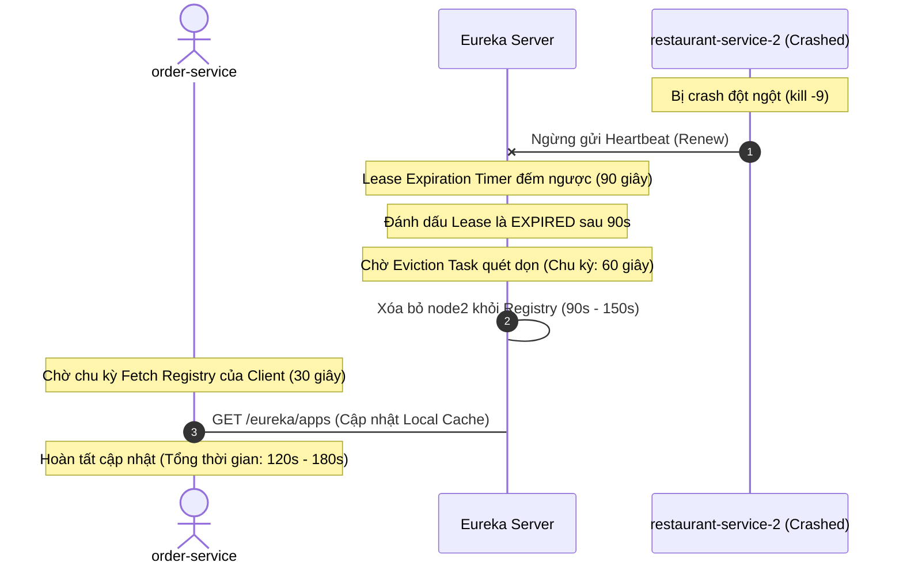

# BÁO CÁO KỸ THUẬT: BÀI TẬP 2 VÀ BÀI TẬP 4  
## SESSION 02: TỪ MONOLITHIC ĐẾN MICROSERVICE — HỆ THỐNG FOODX

---

**Thông tin bài tập:**
- **Môn học:** Thiết kế và Kiến trúc Hệ thống Microservices (IT209)
- **Hệ thống áp dụng:** Nền tảng giao đồ ăn FoodX (FoodX Delivery Ecosystem)
- **Nội dung thực hiện:**
  - **Bài 2:** Tổ chức Centralized Configuration cho hệ thống FoodX (Cấp độ: Vận dụng cơ bản)
  - **Bài 4:** Phân tích sự cố Service Discovery khi scale hệ thống (Cấp độ: Phân tích)

---

# PHẦN I: BÀI 2 — TỔ CHỨC CENTRALIZED CONFIGURATION CHO HỆ THỐNG FOODX

## 1. Phân tích lỗi đặt tên file và cơ chế ánh xạ của Spring Cloud Config

### 1.1. Lỗi đặt tên file `config.yml`
- Trong kịch bản, microservice khai báo trong mã nguồn:
  ```yaml
  spring:
    application:
      name: restaurant-service
  ```
  nhưng thực tập sinh lại đặt tên file trên Git repository là `config.yml`.

### 1.2. Cơ chế ánh xạ tài nguyên của Spring Cloud Config Server
Spring Cloud Config Server tuân thủ chặt chẽ quy ước URL định tuyến tài nguyên:
$$\texttt{GET /\{application\}/\{profile\}[/\{label\}]}$$
Khi một microservice khởi động, nó tự động gửi HTTP Request lên Config Server với:
- `{application}` lấy từ giá trị `spring.application.name`.
- `{profile}` lấy từ giá trị `spring.profiles.active` (nếu không khai báo thì mặc định là `default`).
- `{label}` là branch hoặc tag trên Git (mặc định là `main` hoặc `master`).

Ví dụ, với `restaurant-service`, Config Client sẽ gửi request:
```http
GET http://config-server:8888/restaurant-service/default/main
```
Khi nhận được request trên, Config Server sẽ tìm kiếm trong Git repository các file theo thứ tự ưu tiên:
1. `restaurant-service-default.yml`
2. `restaurant-service.yml`
3. `restaurant-service-default.properties`
4. `restaurant-service.properties`
5. `application-default.yml` / `application.yml` (file cấu hình chung dự phòng cho toàn bộ hệ thống).

Config Server **hoàn toàn không nhận diện được** file `config.yml`, vì nó chỉ nạp `config.yml` nếu tên ứng dụng đăng ký là `config`.

### 1.3. Hậu quả khi không tìm thấy file cấu hình
1. **Dịch vụ không thể khởi động (Startup Crash):** Nếu ứng dụng bật cờ `spring.cloud.config.fail-fast=true`, Spring context sẽ bị ném ngoại lệ dừng khởi động ngay.
2. **Lỗi kết nối cơ sở dữ liệu (Datasource Initialization Failure):** Nếu không bật `fail-fast`, Spring Boot sẽ cố gắng khởi động bằng các thuộc tính mặc định nội bộ. Toàn bộ thông số kết nối Database (`url`, `username`, `password`) bị thiếu hoặc rỗng, dẫn tới `CannotCreateTransactionException` hoặc `HikariPool: Connection refused`, sập toàn bộ tầng dữ liệu.
3. **Xung đột cổng mạng (Port Conflict):** Do không đọc được `server.port: 8085`, ứng dụng sẽ tự động chạy trên cổng mặc định `8080`, dẫn đến xung đột với các service khác hoặc lỗi định tuyến trên API Gateway.

### 1.4. Đổi tên file đúng quy ước
- Đổi tên file từ `config.yml` thành: **`restaurant-service.yml`**
- Nếu phân tách môi trường:
  - `restaurant-service-dev.yml` (Development)
  - `restaurant-service-prod.yml` (Production)

---

## 2. Phân tích rủi ro của Plaintext Password và Giải pháp mã hóa `{cipher}`

### 2.1. Rủi ro khi lưu mật khẩu dạng Plaintext (`RestaurantPass123`)
1. **Rò rỉ thông tin trong Git Repository (Credential Exposure):**
   - Git repository là nơi nhiều thành viên (Dev, Tester, DevOps, Third-party vendors) cùng truy cập. Bất kỳ ai có quyền clone repo đều đọc được mật khẩu database production.
   - Nếu repository bị cấu hình nhầm thành public hoặc tài khoản GitHub/GitLab bị tấn công chiếm quyền, kẻ xấu sẽ có toàn quyền can thiệp vào cơ sở dữ liệu `restaurants_db`.
2. **Lưu vết vĩnh viễn trong Git History:**
   - Git lưu lại toàn bộ commit log (`git log`). Ngay cả khi lập trình viên xóa mật khẩu ở commit mới, mật khẩu cũ vẫn nằm trong commit cũ và có thể dễ dàng bị rà quét bằng các công cụ quét secret (như GitLeaks, TruffleHog).
3. **Vi phạm tiêu chuẩn tuân thủ an ninh mạng:**
   - Vi phạm các tiêu chuẩn bảo mật quốc tế như **PCI-DSS** (Điều 8), **ISO/IEC 27001**, **OWASP Top 10** (A02:2021 - Cryptographic Failures), và vi phạm nguyên tắc bảo mật tối thượng của DevSecOps: *"Không bao giờ hardcode hoặc lưu trữ secret dưới dạng cleartext trong kho mã nguồn"*.

### 2.2. Giải pháp: Cú pháp mã hóa `{cipher}` của Spring Cloud Config
Spring Cloud Config Server tích hợp mô-đun mã hóa sử dụng thuật toán đối xứng (Symmetric AES-256) hoặc bất đối xứng (Asymmetric RSA).

#### Quy trình mã hóa và áp dụng:
1. Quản trị viên gọi API mã hóa của Config Server:
   ```bash
   curl -X POST http://config-server:8888/encrypt -d "RestaurantPass123"
   ```
   Config Server trả về một chuỗi mã hóa, ví dụ: `AQA7b92KxLfNm84QeZ1uP0oRstVwXyZ3AbCdEfGhIjKlMnOpQrStUvWxYz1234567890==`.
2. Đặt chuỗi mã hóa vào file cấu hình trên Git với tiền tố `{cipher}`:
   ```yaml
   spring:
     datasource:
       username: restaurant_service_user
       password: '{cipher}AQA7b92KxLfNm84QeZ1uP0oRstVwXyZ3AbCdEfGhIjKlMnOpQrStUvWxYz1234567890=='
   ```
   *Lưu ý quan trọng:* Chuỗi phải được bao quanh bởi dấu ngoặc đơn (`'...'`) để YAML parser không nhầm lẫn cặp ngoặc nhọn `{}` thành định dạng inline object.
3. Khi microservice gửi request lấy cấu hình, Config Server sẽ tự động giải mã bằng master key nội bộ và trả về giá trị thực thông qua đường truyền mạng HTTPS bảo mật.

---

## 3. Nội dung 3 file cấu hình chuẩn hóa cho 3 Microservices

### 3.1. File `restaurant-service.yml`
```yaml
spring:
  application:
    name: restaurant-service
  datasource:
    url: jdbc:mysql://foodx-cluster.local:3306/restaurants_db
    username: restaurant_service_user
    password: '{cipher}AQA7b92KxLfNm84QeZ1uP0oRstVwXyZ3AbCdEfGhIjKlMnOpQrStUvWxYz1234567890=='
  jpa:
    hibernate:
      ddl-auto: update
    show-sql: false
    properties:
      hibernate:
        dialect: org.hibernate.dialect.MySQL8Dialect

server:
  port: 8085

management:
  endpoints:
    web:
      exposure:
        include: health,info,refresh
```

### 3.2. File `order-service.yml`
```yaml
spring:
  application:
    name: order-service
  datasource:
    url: jdbc:mysql://foodx-cluster.local:3306/orders_db
    username: order_service_user
    password: '{cipher}AQBlk82N90VcxPlmn48QaZopL991KaBvCx0192384756abcdefgh1234567890=='
  jpa:
    hibernate:
      ddl-auto: update
    show-sql: false
    properties:
      hibernate:
        dialect: org.hibernate.dialect.MySQL8Dialect

server:
  port: 8086

management:
  endpoints:
    web:
      exposure:
        include: health,info,refresh
```

### 3.3. File `delivery-service.yml`
```yaml
spring:
  application:
    name: delivery-service
  datasource:
    url: jdbc:mysql://foodx-cluster.local:3306/delivery_db
    username: delivery_service_user
    password: '{cipher}AQCD981ZxqVbn710MlOpQrstU902VaBxYz0987654321qwertyuiop1234567890=='
  jpa:
    hibernate:
      ddl-auto: update
    show-sql: false
    properties:
      hibernate:
        dialect: org.hibernate.dialect.MySQL8Dialect

server:
  port: 8087

management:
  endpoints:
    web:
      exposure:
        include: health,info,refresh
```

---

## 4. Mô tả cấu trúc thư mục Git Repository (README)

```text
foodx-config-repo/
├── README.md                          # Tài liệu quy chuẩn và hướng dẫn vận hành Git repo
├── application.yml                    # Cấu hình chung cho toàn bộ các service (cổng fallback, logging...)
├── application-dev.yml                # Cấu hình chung cho môi trường Development
├── application-prod.yml               # Cấu hình chung cho môi trường Production
│
├── restaurant-service.yml             # Cấu hình cơ sở cho restaurant-service
├── restaurant-service-dev.yml         # Ghi đè thông số cho restaurant-service môi trường dev
├── restaurant-service-prod.yml        # Ghi đè thông số cho restaurant-service môi trường prod
│
├── order-service.yml                  # Cấu hình cơ sở cho order-service
├── order-service-dev.yml              # Ghi đè thông số cho order-service môi trường dev
├── order-service-prod.yml             # Ghi đè thông số cho order-service môi trường prod
│
└── delivery-service.yml               # Cấu hình cơ sở cho delivery-service
    ├── delivery-service-dev.yml       # Ghi đè thông số cho delivery-service môi trường dev
    └── delivery-service-prod.yml      # Ghi đè thông số cho delivery-service môi trường prod
```

---
---

# PHẦN II: BÀI 4 — PHÂN TÍCH SỰ CỐ SERVICE DISCOVERY KHI SCALE HỆ THỐNG FOODX

## 1. Phân tích nguyên nhân gốc rễ sự cố

Tình huống: Khi scale `restaurant-service` từ 1 lên 4 instance, `order-service` vẫn chỉ gọi được 1 instance, và kiểm tra thấy cấu hình Eureka Client của `restaurant-service` bị lỗi khiến nó không thể đăng ký thành công.

Cấu hình ban đầu:
```yaml
spring:
  application:
    name: RestaurantService

eureka:
  client:
    service-url:
      defaultZone: http://eureka-server:8761/eureka
```

---

### 1.1. Lỗi thiếu dấu gạch chéo `/` ở cuối `defaultZone` (Lỗi trực tiếp gây thất bại đăng ký)

#### Cơ chế hoạt động của Eureka Client:
- Eureka Client gửi các yêu cầu REST API (POST để đăng ký, PUT để gửi heartbeat, GET để fetch registry) đến Eureka Server dựa trên URL cơ sở được cấu hình trong thuộc tính `defaultZone`.
- Thư viện client sẽ nối chuỗi đường dẫn tương đối của tài nguyên (`apps/...`) vào sau `defaultZone`.

#### Bản chất lỗi:
- Khi cấu hình: `defaultZone: http://eureka-server:8761/eureka`
- Client sẽ ghép thành URL:
  $$\texttt{http://eureka-server:8761/eureka} + \texttt{apps/...} = \texttt{http://eureka-server:8761/eurekaapps/...}$$
- Eureka Server tiếp nhận request tại đường dẫn không hợp lệ `/eurekaapps`, do đó lập tức trả về mã phản hồi **HTTP 404 Not Found**.
- Client ghi nhận ngoại lệ `TransportException: Cannot execute request on any known server / Status code: 404`, dẫn đến **cả 4 instance mới đều đăng ký thất bại hoàn toàn**.
- Instance duy nhất mà `order-service` vẫn gọi được thực chất là **instance cũ** được kết nối thông qua địa chỉ IP tĩnh hoặc cấu hình cũ còn sót lại trong cache.

#### Cú pháp sửa đúng:
```yaml
defaultZone: http://eureka-server:8761/eureka/  # Bắt buộc phải có dấu '/' kết thúc
```

---

### 1.2. Phân tích sự cố không nhất quán tên gọi `spring.application.name`

Tên hiện tại là `RestaurantService` (PascalCase), trong khi các dịch vụ khác là `order-service`, `payment-service` (kebab-case).

Mặc dù bản thân Eureka Server lưu tên ứng dụng dạng uppercase (`RESTAURANTSERVICE`), nhưng trong kiến trúc Microservices của Spring Cloud, sự bất nhất quán này gây ra các hậu quả nghiêm trọng:
1. **Lỗi tra cứu của OpenFeign và Spring Cloud LoadBalancer:**
   - Trong `order-service`, lập trình viên gọi theo quy chuẩn chung:
     ```java
     @FeignClient(name = "restaurant-service")
     public interface RestaurantClient { ... }
     ```
   - LoadBalancer sẽ tìm kiếm định danh `restaurant-service` trên Registry. Nếu service lại đăng ký là `RestaurantService` (chuyển thành `RESTAURANTSERVICE`), hai chuỗi này không khớp nhau, dẫn đến ngoại lệ:
     ```text
     EmptyResponseException: No instances available for restaurant-service
     ```
2. **Lỗi định tuyến tự động trên Spring Cloud Gateway:**
   - Gateway sử dụng cơ chế Discovery Locator với đường dẫn `lb://{service-name}`. Sự sai khác này sinh ra các route `/RESTAURANTSERVICE/**` thay vì `/restaurant-service/**`, phá vỡ quy ước URI RESTful của toàn hệ thống.
3. **Lỗi phân giải tên trong hệ thống Container & Monitoring:**
   - DNS của Kubernetes và Docker Compose bắt buộc sử dụng chữ thường theo chuẩn RFC 1123. Tên chứa chữ hoa sẽ gây lỗi truy vấn DNS nội bộ hoặc gắn sai nhãn trong Prometheus metrics (`app="restaurant-service"`).

---

### 1.3. Vấn đề trùng lặp `instance-id` khi Scale 4 Instance
- Nếu 4 instance cùng chạy trên một máy chủ (hoặc dùng chung network host trong container) mà không khai báo `instance-id` duy nhất, Eureka Server sẽ nhận diện chúng bằng cùng một định danh (`hostname:port`).
- Khi đó, **instance sau sẽ ghi đè lên instance trước**, khiến Eureka chỉ lưu trữ 1 instance duy nhất thay vì 4 instance.
- **Khắc phục:** Bổ sung cấu hình `instance-id` với giá trị ngẫu nhiên hoặc IP:Port độc lập.

---

## 2. File cấu hình Eureka Client đã sửa đúng cho `restaurant-service`

```yaml
# ===================================================================
# Cấu hình Eureka Client CHUẨN XÁC cho restaurant-service
# ===================================================================
spring:
  application:
    # 1. Đổi tên về đúng chuẩn kebab-case
    name: restaurant-service

server:
  port: 8085

eureka:
  instance:
    # 2. Định danh duy nhất cho từng instance khi scale (tránh ghi đè lên nhau)
    instance-id: ${spring.application.name}:${spring.cloud.client.ip-address:${server.address:localhost}}:${server.port}:${random.value}
    # 3. Ưu tiên đăng ký bằng IP thay vì hostname máy chủ
    prefer-ip-address: true
    # 4. Chu kỳ gửi tín hiệu Heartbeat lên Eureka Server
    lease-renewal-interval-in-seconds: 10
    # 5. Thời gian Eureka Server chờ trước khi đánh dấu hết hạn
    lease-expiration-duration-in-seconds: 30

  client:
    # 6. Khai báo minh bạch 2 cờ cốt lõi
    register-with-eureka: true
    fetch-registry: true
    service-url:
      # 7. Sửa lỗi: Thêm dấu '/' ở cuối
      defaultZone: http://eureka-server:8761/eureka/

management:
  endpoints:
    web:
      exposure:
        include: health,info
```

---

## 3. Cơ chế Heartbeat của Eureka khi Instance bị Crash đột ngột

Giả sử `restaurant-service-2` bị crash đột ngột (do OOM Killer, lệnh `kill -9`, hoặc sập nguồn) mà **không kịp gửi tín hiệu shutdown (`DELETE /eureka/apps/...`)**. Quy trình xử lý của Eureka diễn ra như sau:



### 3.1. Các thông số thời gian chi tiết
1. **Heartbeat định kỳ (`lease-renewal-interval-in-seconds`):**
   - Mặc định: **30 giây**. Các node khỏe mạnh cứ 30s gửi heartbeat một lần. Node bị crash sẽ dừng gửi.
2. **Thời hạn hết hạn hợp đồng thuê (`lease-expiration-duration-in-seconds`):**
   - Mặc định: **90 giây**. Nếu sau 90 giây Eureka Server không nhận được heartbeat từ `restaurant-service-2`, node này bị coi là đã hết hạn.
3. **Tác vụ quét dọn định kỳ của Server (`eviction-interval-timer-in-ms`):**
   - Mặc định: **60 giây** (60000ms). Background thread của Eureka Server định kỳ mỗi 60 giây quét một lần để xóa các node đã hết hạn.
4. **Chu kỳ cập nhật danh sách của Client (`registry-fetch-interval-seconds`):**
   - Mặc định: **30 giây**. `order-service` lưu trữ registry trong bộ nhớ đệm (cache), mỗi 30s mới hỏi Eureka Server một lần.

### 3.2. Tổng thời gian loại bỏ hoàn toàn instance bị crash
- **Tại Eureka Server:** Mất từ **90 giây đến 150 giây** (90s expiration + tối đa 60s chờ eviction task).
- **Tại `order-service`:** Mất thêm tối đa **30 giây** để cache của client hết hạn và fetch danh sách mới.
- **Tổng thời gian thực tế `order-service` có thể tiếp tục gửi request vào node lỗi:**
  $$\mathbf{T = 120 \text{ giây} \sim 180 \text{ giây} \quad (2 \text{ đến } 3 \text{ phút})}$$

### 3.3. Hiện tượng Self-Preservation Mode (Tự bảo vệ)
- Nếu trong vòng 15 phút, tỷ lệ heartbeat nhận được thực tế thấp hơn **85%** (`renewal-percent-threshold = 0.85`) so với kỳ vọng (thường do sự cố đứt mạng diện rộng giữa các datacenter), Eureka Server sẽ kích hoạt **Self-Preservation Mode**.
- Khi kích hoạt, Eureka Server sẽ **KHÓA TOÀN BỘ REGISTRY** và **KHÔNG XÓA BẤT KỲ NODE NÀO**, khiến `restaurant-service-2` vẫn tồn tại trong danh sách discovery mãi mãi cho đến khi mạng ổn định hoặc quản trị viên can thiệp.

---

## 4. Đề xuất cấu hình và kiến trúc cho `order-service`

Để `order-service` luôn tra cứu danh sách 4 instance mới nhất, tự động cân bằng tải và chịu lỗi khi có instance sập, cần thực hiện 3 giải pháp:

### 4.1. Sử dụng Spring Cloud OpenFeign (Loại bỏ địa chỉ IP cứng)
Không gọi URL cố định. Khai báo Feign Client với tên logic:
```java
@FeignClient(name = "restaurant-service")
public interface RestaurantClient {
    @GetMapping("/api/v1/restaurants/{id}")
    RestaurantDTO getRestaurantById(@PathVariable("id") Long id);
}
```
Spring Cloud LoadBalancer sẽ tự động phân phối request theo thuật toán **Round-Robin** qua cả 4 instance.

### 4.2. Tối ưu hóa cấu hình Caching trong `application.yml` của `order-service`
```yaml
spring:
  application:
    name: order-service

server:
  port: 8086

eureka:
  client:
    register-with-eureka: true
    fetch-registry: true
    service-url:
      defaultZone: http://eureka-server:8761/eureka/
    # Rút ngắn chu kỳ fetch registry xuống 10s để phát hiện scale-up nhanh chóng
    registry-fetch-interval-seconds: 10

# Cấu hình Spring Cloud LoadBalancer
spring:
  cloud:
    loadbalancer:
      cache:
        ttl: 5s # Thời gian sống của cache instance tại client
```

### 4.3. Bắt buộc tích hợp Circuit Breaker và Retry (Resilience4j)
Do Eureka mất từ 120s đến 180s mới xóa node crash, `order-service` **bắt buộc phải có Circuit Breaker và Retry** để không làm hỏng trải nghiệm người dùng:
1. **Retry:** Khi gọi vào `restaurant-service-2` bị Connection Timeout, tự động chuyển ngay sang `restaurant-service-1`, `3` hoặc `4`.
2. **Circuit Breaker:** Khi tỷ lệ lỗi gửi tới node 2 vượt quá 50%, ngắt mạch (OPEN), lập tức từ chối gọi vào node đó mà không phải chờ timeout.

```yaml
resilience4j:
  retry:
    instances:
      restaurantClient:
        max-attempts: 3
        wait-duration: 200ms
  circuitbreaker:
    instances:
      restaurantClient:
        sliding-window-size: 10
        failure-rate-threshold: 50
        wait-duration-in-open-state: 10000ms
```

---

# PHẦN III: KẾT LUẬN VÀ BÀI HỌC KINH NGHIỆM

1. **Về Centralized Configuration:**
   - Tuyệt đối tuân thủ quy ước đặt tên file `{application}-{profile}.yml` để Config Server định tuyến chính xác.
   - Luôn áp dụng cơ chế mã hóa `{cipher}` cho toàn bộ mật khẩu và secret trước khi đẩy lên Git repository.
2. **Về Service Discovery & Scale hệ thống:**
   - Chú ý từng ký tự trong cấu hình hạ tầng (điển hình là dấu `/` ở cuối `defaultZone`).
   - Luôn sử dụng quy chuẩn đặt tên nhất quán (**kebab-case**) cho tất cả các microservices.
   - Khi scale đa instance, bắt buộc phải có `instance-id` duy nhất và kết hợp chặt chẽ giữa **Service Discovery**, **Client-side Load Balancing** và **Circuit Breaker (Resilience4j)** để đạt độ sẵn sàng cao (High Availability).
